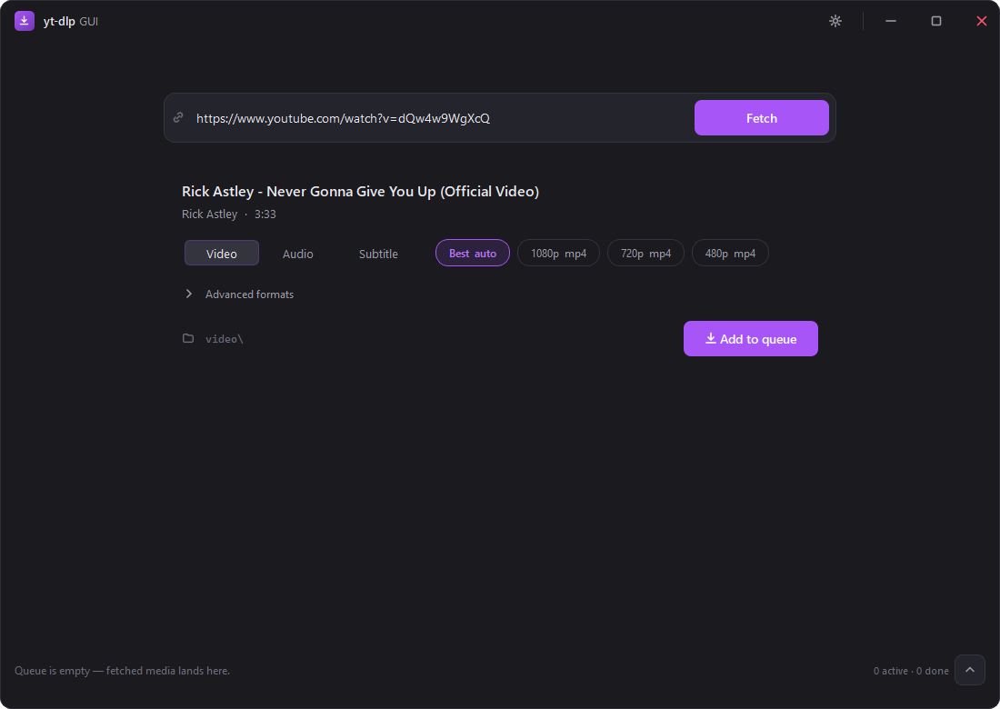

# yt-dlp GUI

A dark-themed **PySide6 desktop GUI for [yt-dlp](https://github.com/yt-dlp/yt-dlp)** (Windows-first).
Paste a link, pick a real available format, and download — with a built-in queue, playlist
downloads, renaming of finished files, cookie support for sign-in/age-restricted content, audio
extraction, subtitles, and one-click yt-dlp self-update.

> **Status:** in development (`0.1.0`).
>
> 📖 **Documentation:** <https://nikiliskage.github.io/ytdlpgui/>



## Why
Using yt-dlp from the command line, a few things are annoying:
1. Guessing format strings → *"Requested format is not available"*.
2. Age-restricted / sign-in videos failing.
3. Grabbing *part* of a playlist means hand-writing `--playlist-items` ranges.

This GUI fixes these: it **fetches the video's real available formats** into a clickable list,
offers an **optional cookie module** (read locally, never stored) for sign-in content, and lists a
**playlist's videos as a checklist** so you tick exactly the ones you want.

## Requirements
This app does **not** bundle the binaries — you provide them (keeps the download small and
avoids antivirus/SmartScreen false positives and ffmpeg licensing concerns):

- **yt-dlp.exe** — https://github.com/yt-dlp/yt-dlp/releases
- **ffmpeg.exe** — https://www.gyan.dev/ffmpeg/builds/ (needed for merging video+audio and audio conversion)

Put both **next to the app** (the install folder), or point to them in **Settings → Binaries**.
Those are the only two places the app looks — it never picks up a yt-dlp/ffmpeg from your PATH or
another folder. (In a source checkout, the repo root counts as the app's folder.)

## Install (from source, during development)
```powershell
pip install -r requirements-dev.txt
# put yt-dlp.exe and ffmpeg.exe in the repo root (or set them later in Settings → Binaries)
python main.py
```
Checks (same as CI): `ruff check . ; ruff format --check . ; mypy app ; pytest -m "not network"`.
See the [development guide](docs/development.md) for details.

## Packaged build
A single GUI `.exe` is produced with PyInstaller (binaries stay external):
```powershell
pyinstaller ytdlpgui.spec
```
A Windows **setup installer** (with a license/disclaimer you must accept, a Start Menu
shortcut, and an uninstaller; installs per-user — no admin — under
`%LocalAppData%\Programs\yt-dlp-gui`, with downloads defaulting to `Documents\yt-dlp-gui\video`
and `\audio`) is built from `installer/ytdlpgui.iss` with
[Inno Setup 6](https://jrsoftware.org/isinfo.php) (`winget install JRSoftware.InnoSetup`).
One command builds the exe **and** the installer — it finds `ISCC.exe` itself and takes the
version from `app/__init__.py`:
```powershell
powershell -ExecutionPolicy Bypass -File tools\build_installer.ps1
# -> installer\Output\ytdlpgui-setup-<version>.exe
```
> The unsigned `.exe`/installer may trigger a Windows SmartScreen prompt ("More info → Run anyway").

## Features
- Real-format selector (quality chips + advanced format table); video downloads prefer AAC audio
  so the resulting mp4 plays everywhere
- Download queue (up to 2 concurrent), cancel / retry; cancelling (or a failed job) cleans up the
  partial files it left behind
- **Playlists** — paste a playlist link (or open the playlist from a video that's part of one),
  tick the videos you want, and each is queued as its own job into
  `<Video|Audio>\<Playlist name>\01 - Title.ext`
- **Rename** a finished download from the queue (its subtitle/thumbnail files follow along)
- Audio extraction — **Best audio** keeps the source codec, or convert to opus / mp3 / m4a
- Subtitles: pick languages (Settings, up to 2); the picker greys out languages a video doesn't offer
- Thumbnail / metadata embedding
- Cookie module for sign-in / age-restricted content — **Firefox** (`--cookies-from-browser`) or a
  **cookies.txt** file; applied at fetch *and* download time (read locally, never stored). A one-time
  disclaimer is shown before it's first enabled.
- Clear, actionable errors (age/sign-in, geo-block, rate-limit, ffmpeg, network) with an inline
  "Enable cookies" shortcut where relevant
- One-click "Update yt-dlp" (`yt-dlp -U`)

## FAQ
- **Age-restricted / sign-in video won't fetch or download?** Enable the cookie module
  (Settings → Cookies) and choose **Firefox** or a **cookies.txt** file. Chrome/Edge can't be read
  directly (Chromium app-bound cookie encryption) — export a `cookies.txt` for those. If it still
  fails, the site may require a PO token — see the [yt-dlp wiki](https://github.com/yt-dlp/yt-dlp/wiki).
- **"yt-dlp not found" / "ffmpeg not found"?** Put the `.exe` next to the app (the install folder),
  or set its path in Settings → Binaries. The app does not look in your PATH or in `C:\yt-dlp`.
- **How do I download only some videos of a playlist?** Paste the playlist link and untick the ones
  you don't want. For a `watch?v=…&list=…` link, the video opens first — click **Open playlist** on
  the media card. Files are numbered in playlist order inside a folder named after the playlist.
- **Can I rename a file after it downloaded?** Yes — click the pencil on the finished job in the
  queue, type the new name, press Enter. The extension is kept and matching subtitle/thumbnail
  files are renamed too.
- **Cookies safe?** They are read locally and passed only to yt-dlp for the download — never stored
  or transmitted by this app. See [SECURITY.md](SECURITY.md). Prefer a secondary account.

## Legal
You are responsible for complying with the terms of service of the sites you download from and
with applicable copyright law. This tool is for personal, lawful use.

## License
[MIT](LICENSE).
